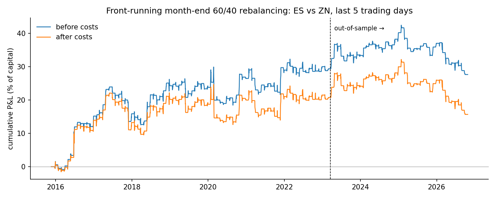
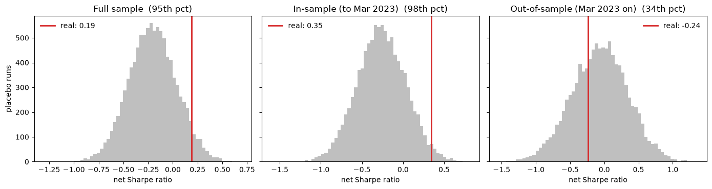

# Front-Running Month-End Rebalancing (ES vs. ZN)

[](https://github.com/aharode/rebalancing-frontrun/actions/workflows/ci.yml)

Does month-end pension rebalancing create a tradable pattern in S&P 500 vs. 10-year
Treasury futures, and does it survive after the research documenting it?

This project tests the Calendar rebalancing effect from Harvey, Mazzoleni & Melone,
[*The Unintended Consequences of Rebalancing*](https://www.edhec.edu/sites/default/files/2026-03/Scientific%20paper.%20ssrn-5122748.pdf)
(2026), on official CME settlement data, with an out-of-sample period that starts where the
paper's data ends.



## Result

A weak in-sample edge that does not persist out-of-sample.

| Net of costs | In-sample (Nov 2015 – Mar 2023) | Out-of-sample (Mar 2023 – Oct 2026) |
|---|---|---|
| Sharpe ratio (annualized) | 0.35 | −0.24 |
| t-stat on monthly trades | 1.00 | −0.46 |
| Hit rate (months) | 52% | 49% |
| Average trade | +24 bps | −12 bps |
| Trades | 87 | 43 |

The conclusion holds under the paper's exact trade timing (in-sample net Sharpe 0.40,
out-of-sample −0.32) and with zero transaction costs (out-of-sample Sharpe −0.08). Excluding
2020 leaves the full-sample result unchanged, so it is not driven by the COVID crash. The
in-sample result is concentrated, though: 2016 alone contributed 13.6 of the 20.8 percentage
points of in-sample net P&L, mostly from June 2016, when the month-end window began the day
after the Brexit vote.

The paper reports a Sharpe ratio above 1 for 1997–2023, but for a strategy combining two
signals and drawing much of its return from the 2008 and 2020 crises. A Calendar-only,
post-2015 version is weaker, and the published edge does not appear after the paper's sample.

### Placebo test: does month-end timing matter?

The same trade was run 10,000 times on a randomly placed 5-day window inside each month
instead of the last 5 days, with identical signal, sizing and costs.



| Net of costs | Real Sharpe | Placebo 5%–95% | Real strategy's percentile | p-value |
|---|---|---|---|---|
| In-sample | 0.35 | −0.75 to 0.22 | 98th | 0.02 |
| Out-of-sample | −0.24 | −0.75 to 0.59 | 34th | 0.67 |

In-sample, trading the last week of the month beat 98% of random-week versions, in line with
the paper's finding over the same period. Out-of-sample, it did no better than a random week.
Part of the in-sample edge comes from 2016: starting the data in 2017, the real strategy beats
90% of placebo runs (p = 0.10). The average placebo run loses money (in-sample Sharpe −0.26),
so betting against month-to-date performance only paid in the last week of the month, and
only until 2023.

## Hypothesis

Pensions and balanced funds target fixed stock/bond weights (often 60/40) and rebalance near
month-end. If stocks have outperformed bonds month-to-date, they must sell equities and buy
bonds, which pushes prices predictably. A front-runner takes the same side first:

- equities overweight → short ES, long ZN
- equities underweight → long ES, short ZN

## Method

**Signal.** Simulate a 60/40 ES/ZN portfolio that drifts with daily returns and resets to
target after the last trading day of each month. The signal is the equity weight's drift from
60% at each close. It matches the paper's analytical approximation, 0.24 × month-to-date
(ES − ZN) return, with 0.999 correlation at month-ends.

**Strategy.**
- Trade only in the last 5 trading days of each month. Flat otherwise.
- Each day's position is set at the previous close, so there is no look-ahead.
- Direction from the sign of the signal. Each leg sized to 10% annualized volatility using a
  trailing 60-day estimate, so the trade is stocks vs. bonds rather than mostly equity risk.
- Costs of about one tick per side on notional traded (ES 0.5 bp, ZN 1.5 bp).

**Evaluation.** In-sample overlaps the end of the paper's sample (through March 17, 2023).
Out-of-sample is everything after. Two checks were fixed before looking at results: the
paper's exact timing (front-run the last 4 days, then take the opposite side on the first
day of the next month, where the paper finds a partial reversal), and cost sensitivity. A
placebo test then compares the real strategy with 10,000 versions that trade a random week
of each month.

## Data

Daily official CME settlement prices and cleared volume for every ES and ZN contract, from
[Databento](https://databento.com) (GLBX.MDP3 `statistics` schema). The full pull costs
about $1 in data credits.

Cleaning rules, each checked against the data:
- Calendar spreads, zero prices, and Sunday replay records (re-sent prior settlements with no
  trade date) are dropped. A few records with weekend trade dates are dropped.
- The last settlement published for each contract and day is used. Where settlement flags
  can be read, this matched the "final, actual" settlement 100% of the time.
- **Roll:** hold the contract with the most volume on the previous day. Each day's return
  compares the same contract's settlements, so rolls never create price jumps.
- Returns start in November 2015 because cleared volume is not available before then.
- Databento has no ZN settlement on 2020-02-27 and 2020-06-30. Both were filled from
  Barchart's per-contract history, which matches Databento exactly on the surrounding days.
  See `MANUAL_FILLS` in `settlements.py`.
- ES did not trade on 2025-01-09 (national day of mourning) or 2026-04-03 (Good Friday).
  Those days are treated as flat.

## C++ engine

The backtest and placebo test also run in a C++ engine (`cpp/engine.cpp`, called from Python
through pybind11 and built automatically by `uv sync`). The Python implementation remains the
reference: tests check that the C++ engine reproduces it to within 1e-12 for both timing
conventions and a range of parameters, and that the placebo reproduces the real strategy
exactly when every month has only one possible 5-day window.

| | Python | C++ | Speedup |
|---|---|---|---|
| One backtest | 5.4 ms (pandas) | 1.8 ms | 3× |
| One placebo simulation | 395 µs (vectorized NumPy) | 23 µs | 17× |
| 10,000 placebo simulations | ~3.9 s | 0.23 s | 17× |

Measured on Linux (aarch64), Python 3.11; rerun with `uv run python benchmarks/benchmark.py`.
The single-backtest speedup is small because pandas calendar setup dominates; the placebo
loop is where C++ helps.

## Repository

```
src/rebalancing_frontrun/
  data/databento_loader.py   cost quotes, cost-capped and cached Databento pulls
  data/settlements.py        settlement table and roll-aware daily returns
  signals/calendar.py        trading calendar and 60/40 Calendar signal
  backtest/strategy.py       positions, costs, P&L and performance metrics (reference)
  backtest/fast.py           pandas interface to the C++ engine; placebo test
cpp/engine.cpp               C++ backtest and placebo engine (pybind11)
tests/                       pytest suite, run in CI on every push
benchmarks/benchmark.py      Python vs. C++ timing
notebooks/
  02_calendar_signal_checks.ipynb   signal validation
  03_strategy_backtest.ipynb        results, paper-timing and cost checks
  04_placebo.ipynb                  real strategy vs. 10,000 random-timing runs
```

## Reproduce

Requires [uv](https://docs.astral.sh/uv/), a C++17 compiler (on macOS:
`xcode-select --install`) and a Databento API key.

```bash
uv sync                                                            # installs and builds the C++ engine
uv run pytest                                                      # tests use synthetic data, no key needed
echo "DATABENTO_API_KEY=your_key" > .env
uv run python src/rebalancing_frontrun/data/databento_loader.py   # pulls and caches raw data (~$1)
uv run python src/rebalancing_frontrun/data/settlements.py        # builds data/processed/
uv run python benchmarks/benchmark.py                              # optional: Python vs. C++ timing
```

Then run the notebooks in order.

## Next steps

- Where in the month the effect is strongest: sweep the trading window's position.
- The paper's Threshold signal, which rebalances when weights drift past a band.
- Quarter-end vs. other month-ends, where the paper finds stronger pressure.
- Pre-2015 history using an expiration-based roll.
